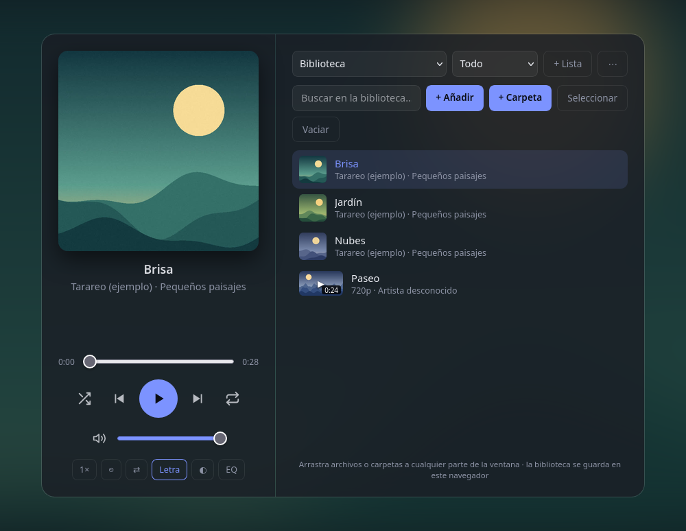
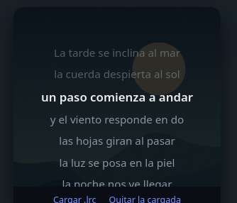
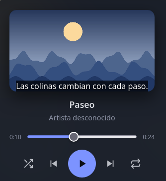

<p align="center">
  
</p>

<h1 align="center">Tarareo</h1>

<p align="center">
  Reproductor de música y video local, en el navegador o como app de escritorio.<br>
  Tus archivos nunca salen de tu equipo.
</p>

<p align="center">
  <a href="https://github.com/FabricioCT-user/tarareo/actions/workflows/test.yml"></a>
  <a href="LICENSE"></a>
</p>

<p align="center">
  <a href="https://fabricioct-user.github.io/tarareo/"></a>
</p>

## Capturas







## Funciones

- **Biblioteca** que se guarda en el navegador: añade archivos, carpetas enteras (con subcarpetas) o arrástralos a la ventana. Búsqueda y orden arrastrando.
- **Audio** en MP3, FLAC, Ogg Vorbis, Opus, M4A y WAV; **video** en MP4, WebM, MKV y MOV, según los códecs que soporte tu navegador o Electron.
- **Listas** con nombre, cola de reproducción y exportación o importación en JSON o M3U8.
- **Fundido** entre canciones, temporizador de apagado, ecualizador de 10 bandas y velocidad de 0,5× a 2× sin cambiar el tono.
- **Letras sincronizadas**, incrustadas o en archivos `.lrc`. Pulsa una línea para saltar a ella.
- **Etiquetas**: edita título, artista, álbum y carátula de una o varias pistas. Los originales no se modifican; puedes descargar una copia con las etiquetas escritas (MP3 y FLAC).
- **Video**: pantalla completa, imagen en imagen, subtítulos SRT y WebVTT, y miniaturas.
- **App de escritorio**: se abre con «Abrir con…» y enlaza los videos sin copiarlos.
- **Instalable** como app web (PWA), con tema claro u oscuro, y funciona sin conexión.

## Instalación

**Demo, sin instalar nada:** [fabricioct-user.github.io/tarareo](https://fabricioct-user.github.io/tarareo/). Pulsa «Probar con ejemplos» con la biblioteca vacía.

**App de escritorio (Linux x64)**, desde [Releases](https://github.com/FabricioCT-user/tarareo/releases):

- **Arch Linux:** paquete `.pacman` → `sudo pacman -U <archivo>.pacman`.
- **Otras distribuciones:** `.AppImage` → `chmod +x <archivo>.AppImage` y ejecútalo. En Ubuntu 23.10 o posterior puede no arrancar; ver [docs/ESCRITORIO.md](docs/ESCRITORIO.md).

**Versión web desde el código** (requiere Node.js y npm; también sirve Python 3):

```bash
git clone https://github.com/FabricioCT-user/tarareo.git
cd tarareo
npm run web          # http://127.0.0.1:8000
```

Para la app de escritorio desde el código: `npm install && npm start`. Más detalles en [docs/ESCRITORIO.md](docs/ESCRITORIO.md).

## Atajos esenciales

| Tecla | Acción |
|---|---|
| `Espacio` | Reproducir / pausar |
| `←` / `→` | Retroceder / avanzar 5 s |
| `N` / `P` | Siguiente / anterior |
| `S` / `R` | Aleatorio / repetir |
| `↑` / `↓` | Volumen |
| `L` | Mostrar / ocultar letra (audio) |
| `F` / `I` | Pantalla completa / imagen en imagen (video) |
| `C` | Subtítulos activados / desactivados (video) |

La lista completa está en [docs/USO.md](docs/USO.md#atajos).

## Cómo está hecho

- Sin build ni dependencias de ejecución: JavaScript clásico con scripts globales. Electron y electron-builder solo sirven para empaquetar la app de escritorio.
- Lectores propios de etiquetas y contenedores: ID3v2.2–2.4, FLAC, Ogg/Opus, átomos MP4 (sin cargar el video en memoria) y EBML para MKV y WebM, además de SRT y WebVTT.
- Las copias con etiquetas reescriben solo los campos editados, conservan el audio byte a byte y se releen para comprobarlas antes de descargarlas.
- La biblioteca va en IndexedDB, con metadatos y archivos en almacenes separados, y la migración de esquema es atómica (v1 → v2).
- En escritorio, la interfaz nunca recibe rutas: pide los bytes con un id de un solo uso. Los videos enlazados se sirven con cabeceras `Range`, leyendo por trozos.
- CSP estricta, sin `unsafe-inline` ni `unsafe-eval`. La ventana de Electron usa aislamiento de contexto y sandbox, y nunca se arranca con `--no-sandbox`.
- 231 pruebas unitarias con `node:test`, sin Electron; pruebas de humo en el navegador y dentro de Electron; CI en GitHub Actions.

## Privacidad

No hay servidor remoto, análisis ni telemetría, y la app de escritorio no tiene auto-actualización. El servidor web local escucha solo en `127.0.0.1`. Aparte de cargar la propia app, la única descarga es la de los ejemplos desde el mismo sitio, y solo cuando pulsas «Probar con ejemplos». Una política de seguridad de contenido impide cargar nada de otros sitios.

## Límites principales

- La app de escritorio es solo para Linux x64, probada en Arch Linux. El `.deb` para Ubuntu no está probado.
- Las copias con etiquetas solo existen para MP3 y FLAC. Las ediciones y las letras viven en la app y no viajan con el archivo.
- Probado en Chromium. En Firefox se ha comprobado la importación de la demo; el resto no. Safari no se ha probado.
- La lista de canciones no está virtualizada: con cientos va bien; con decenas de miles no se ha probado.

## Más documentación

- [Guía de uso](docs/USO.md): funciones, atajos completos, versión web y formatos.
- [App de escritorio](docs/ESCRITORIO.md): paquetes, sandbox, archivos abiertos y datos.
- [Desarrollo](docs/DESARROLLO.md): estructura, pruebas, convenciones y hoja de ruta.

## Licencia

[MIT](LICENSE).
